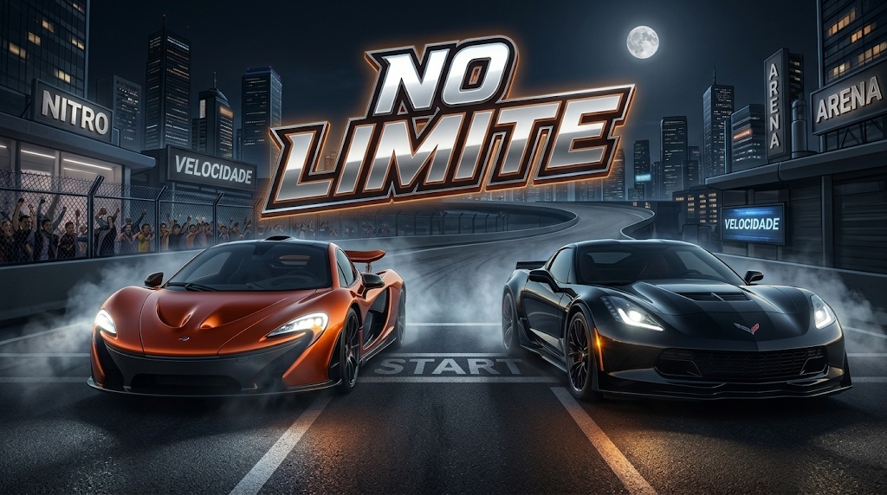

# 🏎️ NO LIMITE

### Sinta a velocidade. Domine as pistas. Vença a corrida!

---

# 🏁 SOBRE O JOGO
 
**NO LIMITE** é um jogo de corrida 3D onde você pode escolher seus carros, disputar corridas, avançar por fases e conquistar recompensas.

Prepare-se para acelerar, melhorar sua coleção de veículos e mostrar suas habilidades nas pistas!

---

# 🎮 MODOS DE JOGO

## 🏎️ Corrida Rápida

- Utilize qualquer carro sem precisar comprá-lo.
- Entre diretamente nas corridas.
- Teste diferentes veículos.

## 🏆 Modo Fases

- Comece com o Mustang e 0 moedas.
- Avance pelas fases.
- Ganhe moedas e estrelas.
- Conquiste diamantes ao conseguir vitórias de 3 estrelas.
- Desbloqueie novos veículos.

## 🚘 Meus Carros

- Acesse um estacionamento exclusivo.
- Visualize somente os veículos que você possui.

## 🏁 Assistir Corrida

- Escolha dois carros.
- Assista à disputa entre eles sem precisar dirigir.

---

# 🕹️ COMO JOGAR

## Direção e velocidade

| Tecla | Função |
|:---:|---|
| `W` ou `↑` | Acelerar |
| `S` ou `↓` | Travar |
| `A` | Virar à esquerda |
| `D` | Virar à direita |
| `←` / `→` | Direcionar o carro |
| `Q` | Reduzir marcha |
| `E` | Aumentar marcha |
| `X` | Engatar marcha-atrás (quase parado) |

## 📷 Câmera e recuperação

| Tecla / Ação | Função |
|---|---|
| `C` | Alternar a câmera externa |
| Botão direito + arrastar | Girar a câmera |
| `R` | Reposicionar o carro na pista |
| `||` | Abrir o menu de pausa |

## 📱 CONTROLES PARA CELULAR

- Os controles de toque aparecem automaticamente.
- Personalize o tamanho dos botões.
- Ajuste a posição dos controles nas configurações.

---

# ⭐ SISTEMA DE RECOMPENSAS

O NO LIMITE possui um sistema de progressão:

| Recompensa | Utilidade |
|---|---|
| 🪙 Moedas | Comprar veículos |
| ⭐ Estrelas | Medir o desempenho nas corridas |
| 💎 Diamantes | Recompensa por vitórias de 3 estrelas |
| 🏆 Fases | Avançar nos desafios |

**Progresso do jogador:**

- Cada jogador começa com 0 moedas.
- Todos começam na fase 1.
- O progresso é salvo no dispositivo.

---

# 🚗 GARAGEM

Escolha seus veículos, conheça suas características e prepare-se para correr!

Cada carro possui características próprias:

- Velocidade.
- Potência.
- Número de marchas.
- Desempenho nas pistas.

---

# 🏁 DOWNLOAD DO JOGO

## ESTÁ PRONTO PARA ACELERAR?

### 🏎️ Entre no NO LIMITE!

**Baixe o jogo e comece sua corrida!**

---

# 👨‍💻 DESENVOLVEDOR

Desenvolvido por **Renan**.

Projeto: **NO LIMITE**

---

# 🏎️ NO LIMITE

### A corrida só termina quando você cruza a linha de chegada!

**Desenvolvido por Renan**

